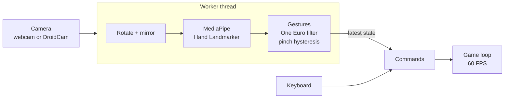

# Hand-controlled falling blocks

A falling-blocks puzzle game you play **with your hand in front of a camera**: move your hand to pick a column, pinch to rotate, make a fist to drop. Hand tracking runs on the CPU with MediaPipe, in real time, with an ordinary webcam or a phone used as one.

<!-- Demo: record a short clip of the game window (board + camera panel) and save it as docs/demo.gif, then uncomment:

-->

## Gestures

| Action | Gesture |
|---|---|
| Move | Move your hand left or right. The target column is highlighted and the piece slides to it |
| Rotate | Pinch: touch thumb and index finger. One rotation per pinch |
| Soft drop | Close your hand into a fist |

The keyboard (arrow keys) keeps working alongside the hand.

## How it works



- **The game never waits for the camera.** Capture and inference run in a worker thread that only publishes its latest state. The game loop reads it under a lock and keeps a steady 60 FPS even if detection slows down.
- **Every controller is an input source.** Each source turns what the player does into a `Commands` snapshot per frame (left, right, rotate, soft drop and an optional *target column*), and the game merges all sources. Adding a new controller does not touch the game logic (`src/controls.py`).
- **Absolute column, not swipes.** The hand's horizontal position (middle of the image, so edge columns are reachable without leaving the frame) maps to a column. That is more precise and intuitive than recognizing left/right swipes.
- **Jitter and double-fires are handled explicitly:**
  - the hand position goes through a [One Euro filter](https://gery.casiez.net/1euro/), which smooths noise when the hand is still but follows fast moves;
  - the pinch uses hysteresis (closes below 0.30 and opens above 0.45 of the hand size) and fires only on the rising edge, so one pinch is one rotation;
  - a fist also brings thumb and index together, so it does not count as a pinch.
- **Gesture logic is pure and tested.** `src/gestures.py` has no camera or model code, so it is unit tested with synthetic landmarks.

Measured on an Intel i5-8600K with a phone camera over Wi-Fi (DroidCam, 640x480): **~30 FPS camera pipeline, ~13 ms of processing per frame** (rotation, inference and gestures). Both numbers are shown live in the camera panel.

## Running

Requires [pixi](https://pixi.sh) (Windows or Linux).

```bash
pixi install
pixi run start                              # keyboard only
pixi run python src/main.py --camera 0      # hand control with webcam 0
pixi run test                               # unit tests
```

The hand model (`hand_landmarker.task`) is downloaded to `models/` on the first run.

Camera options:

| Option | Description |
|---|---|
| `--camera` | Device index (`0`, `1`, ...) or stream URL |
| `--rotate` | Rotate the image: `0`, `90`, `180` or `270` |
| `--no-mirror` | Do not mirror the image (mirrored by default, like a mirror) |

### Using a phone as the camera (DroidCam)

With the DroidCam client connected, the phone shows up as a regular webcam. With the phone standing upright:

```bash
pixi run maos     # = python src/main.py --camera 1 --rotate 90
```

Without the PC client, the stream can be read straight from the phone over Wi-Fi:

```bash
pixi run python src/main.py --camera http://<phone-ip>:4747/video --rotate 90
```

## Project layout

```
src/
  main.py         window, command-line options, camera panel
  game.py         board, pieces, collisions, scoring
  controls.py     Commands + keyboard input source
  hand_input.py   camera + MediaPipe worker thread (hand input source)
  gestures.py     pure gesture logic and One Euro filter
tests/            pytest, runs headless
```

## Credits

The base game started from a YouTube tutorial and was used to practice object-oriented programming. Hand control, the input layer and the tests were built on top of it. This is a personal learning project, not affiliated with or endorsed by The Tetris Company.
